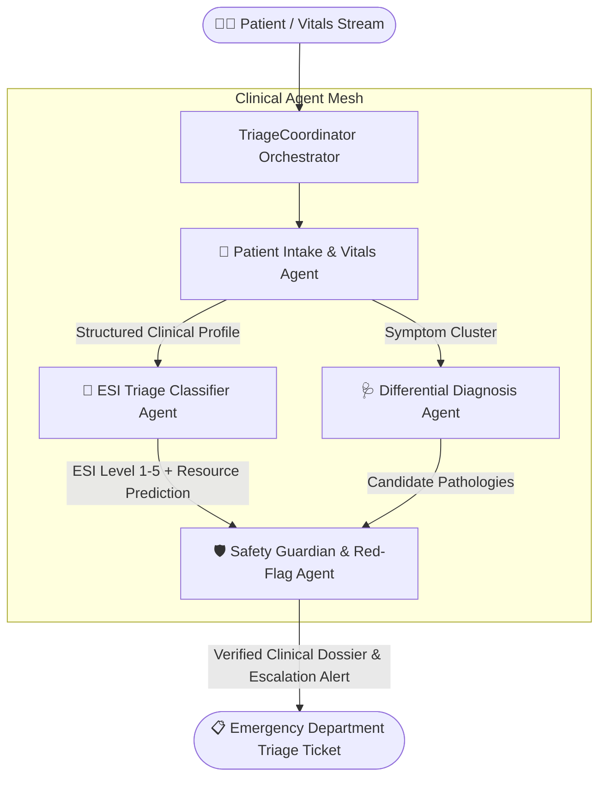

# 🏥 Multi-Agent Medical Triage System

[](https://www.python.org/)
[]()
[]()
[](LICENSE)

An autonomous, collaborative **Multi-Agent Emergency Medical Triage and Clinical Decision Support System** designed to assist hospital emergency departments in fast-tracking life-threatening conditions, calculating Emergency Severity Index (ESI) scores, and preventing diagnostic delays.

---

> [!CAUTION]
> **Academic & Research Disclaimer**: This software is an engineering capstone demonstration for Computer Science study purposes. It is **not** certified for real-world independent clinical diagnosis without licensed physician oversight.

---

## 📌 Problem Statement

Emergency Departments (EDs) worldwide experience acute overcrowding and nurse fatigue:
1. **Triage Bottlenecks**: Delays in initial patient intake cause delayed intervention for acute conditions like myocardial infarction and sepsis.
2. **Human Error Under Fatigue**: Fatigued triage nurses can misclassify critical subtle symptoms (e.g. silent ischemia in diabetic patients).
3. **Resource Misallocation**: Over-assigning non-urgent patients to trauma bays depletes emergency hospital bandwidth.

**Multi-Agent Medical Triage System** deploys specialized, safety-constrained agents that collaborate to evaluate vitals, compute formal ESI triage tiers, generate differential diagnoses, and enforce clinical safety guardrails.

---

## 🧠 Multi-Agent Architecture



---

## 🤖 Specialized Agent Specifications

| Agent | Responsibility | Clinical Standard / Method | Primary Focus |
| :--- | :--- | :--- | :--- |
| **`PatientIntakeAgent`** | Normalizes unstructured patient complaints and vitals | Vitals range validation (SpO2, HR, BP, Temp) | Pain scale (1-10), onset, history, vital anomalies |
| **`ESITriageAgent`** | Classifies into Emergency Severity Index (ESI Levels 1 to 5) | Standard AHRQ ESI 5-Level Triage Algorithm | Distinguishes immediate resuscitation vs outpatient |
| **`DifferentialDiagnosisAgent`** | Matches symptom-vital complexes to candidate conditions | Heuristic probabilistic rule-scoring | Myocardial infarction, Sepsis, Acute Asthma, Viral URI |
| **`SafetyGuardianAgent`** | Enforces clinical guardrails & red-flag overrides | Pediatric/Geriatric modifiers & Red-Flag traps | Overrides triage if red flags detected (e.g. SpO2 < 90%) |
| **`TriageCoordinator`** | Synthesizes hospital bed routing & department alerts | Priority queue dispatcher | Emergency Trauma Bay vs Urgent Care vs Outpatient |

---

## 🏷️ Emergency Severity Index (ESI) Reference

- **ESI Level 1 (Resuscitation)**: Immediate life-saving intervention needed (Cardiac arrest, severe respiratory failure).
- **ESI Level 2 (Emergent)**: High-risk situation, altered mental state, severe pain/distress (Chest pain with diaphoresis, acute stroke signs).
- **ESI Level 3 (Urgent)**: Stable vitals, requires multiple hospital resources (labs + imaging).
- **ESI Level 4 (Less Urgent)**: Requires one diagnostic resource (simple X-ray or stitches).
- **ESI Level 5 (Non-Urgent)**: Routine examination, prescription refill, no diagnostic resources required.

---

## 📂 Repository Structure

```text
Multi-Agent-Medical-Triage-System/
├── README.md                  # Comprehensive clinical system documentation & viva guide
├── requirements.txt           # Minimal dependencies
├── .gitignore                 # Python exclusions
├── demo.py                    # Multi-case emergency room simulation
├── main.py                    # CLI for triaging custom clinical JSON inputs
├── data/
│   └── sample_cases.json      # 4 Diverse patient case studies (Cardiac, Asthma, Trauma, Mild)
└── src/
    ├── __init__.py
    ├── orchestrator.py        # Central multi-agent coordinator
    └── agents/
        ├── __init__.py
        ├── intake_agent.py
        ├── esi_triage_agent.py
        ├── differential_diagnosis_agent.py
        └── safety_guardian_agent.py
```

---

## ⚡ Quickstart & Setup

### 1. Prerequisites
- Python 3.8 or higher.
- Zero external medical API dependencies required for standard deterministic testing.

### 2. Clone the Repository
```bash
git clone https://github.com/ROOPESH23-GIT/Multi-Agent-Medical-Triage-System.git
cd Multi-Agent-Medical-Triage-System
```

### 3. Run the Emergency Department Simulation
Simulates intake and autonomous triaging of 4 incoming emergency room patients:

```bash
python demo.py
```

### 4. Triage a Specific Case
```bash
python main.py --case 1
```

---

## 🖥️ Sample Run Output

```text
===================================================================
🏥 MULTI-AGENT MEDICAL TRIAGE SYSTEM - ED ACTIVE BOARD
===================================================================
Case ID: CASE-01 | Patient: 58y Male | Chief Complaint: Crushing chest pain radiating to left jaw
Vitals: BP: 168/98 mmHg | HR: 112 bpm | SpO2: 93% | Temp: 37.1°C

[Agent: PatientIntake] Normalized vitals. Flagged Tachycardia (112 bpm) and Stage 2 Hypertension.
[Agent: ESITriage] Assigned ESI LEVEL 2 (Emergent)
  Reasoning: High-risk presentation with potential Acute Coronary Syndrome. Immediate ECG and troponin required.
[Agent: DifferentialDiagnosis]
  1. Acute Myocardial Infarction (Confidence: 88%)
  2. Unstable Angina (Confidence: 75%)
  3. Aortic Dissection (Confidence: 42%)
[Agent: SafetyGuardian] 🚨 RED-FLAG VERIFIED: Ischemic signs present. Override lock engaged.
  Disposition: Fast-track to Catheterization Lab / Resuscitation Bay 1.
===================================================================
```

---

## 💡 Key CSE Academic Concepts Demonstrated

1. **Safety-Critical Agentic Systems**: Implementing deterministic fallback safety guards that override model predictions when human life is at risk.
2. **Expert Rule Engines & Fuzzy Matching**: Modeling clinical diagnostic heuristics with confidence estimation.
3. **Structured Event State Transfer**: Passing structured immutable clinical states between collaborating specialized agents.
4. **Queue Prioritization Algorithms**: Applying priority queue ordering to patient streams based on continuous agent urgency scores.

---

## 🎓 Viva-Voce Questions & Answers (For College Defense)

**Q1: What is the Emergency Severity Index (ESI) and why use it?**  
*Answer*: ESI is a 5-level emergency department triage algorithm standardized by the Agency for Healthcare Research and Quality (AHRQ). It evaluates acuity and anticipated resource utilization, providing a reproducible and medically validated metric for agent triage decisions.

**Q2: How does the SafetyGuardianAgent prevent dangerous misclassifications?**  
*Answer*: The SafetyGuardian operates on hard clinical thresholds (e.g. SpO2 < 90%, systolic BP < 90, GCS < 8). If any life-threat criterion is satisfied, the agent triggers an unyielding override that forces the ticket to ESI Level 1 or 2 regardless of lower confidence outputs from the diagnosis agent.

**Q3: How does this project reflect 3rd-year Computer Science concepts?**  
*Answer*: It combines Discrete Mathematics (directed acyclic decision graphs), Software Architecture (Mediator and Strategy patterns), and Knowledge Representation (ontological symptom-disease mappings).

---

## 📜 License
This project is open-source under the [MIT License](LICENSE).
